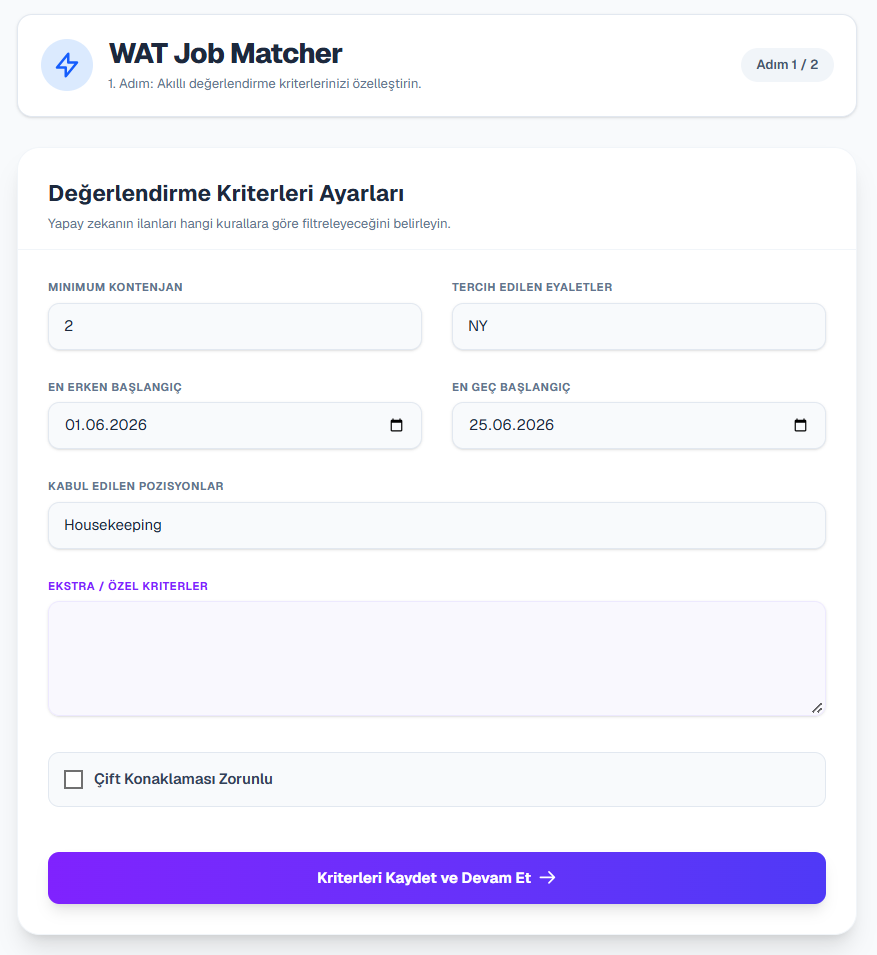
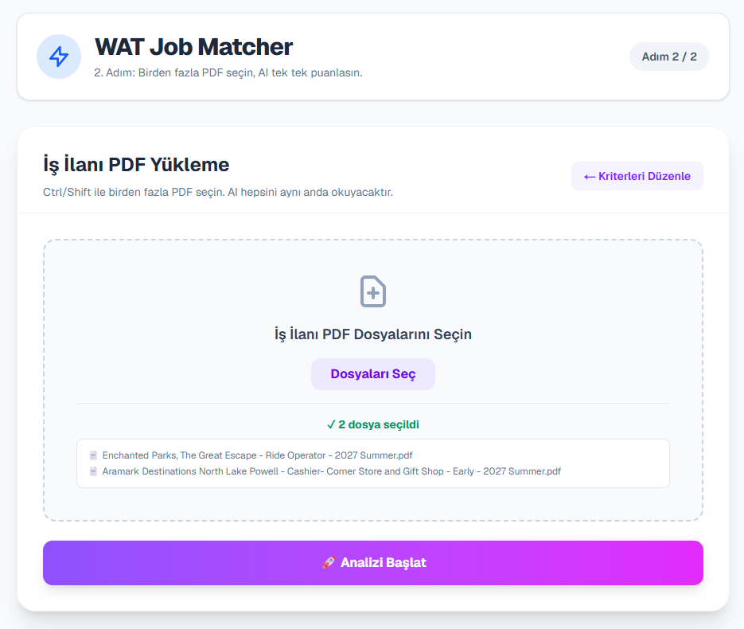
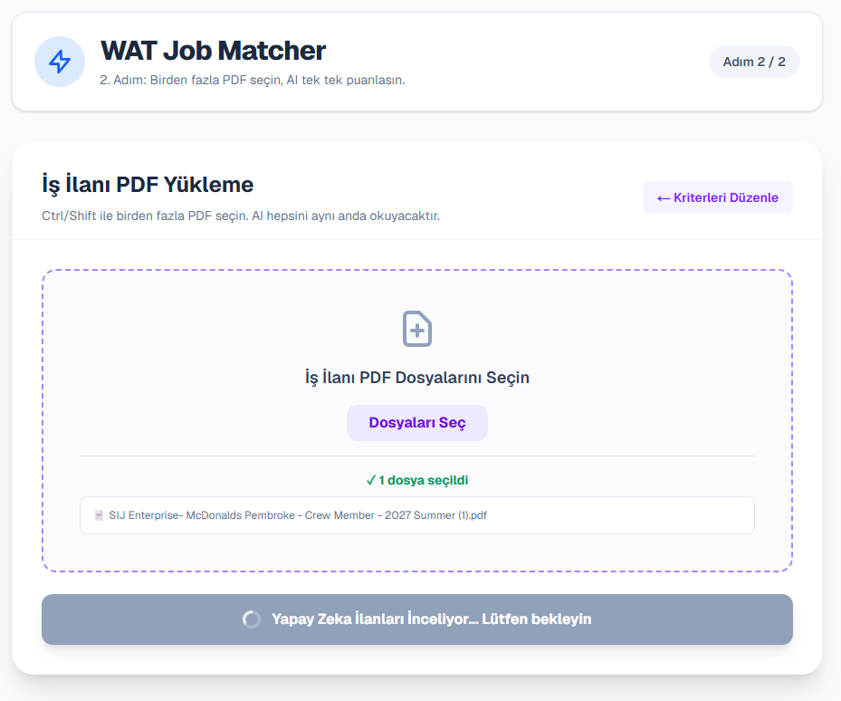
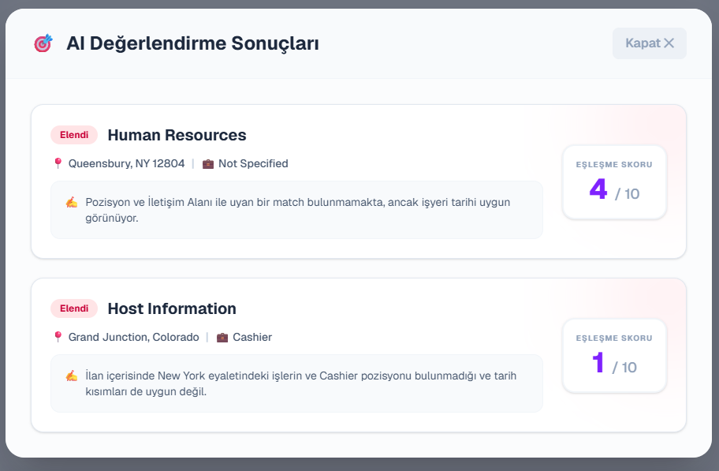
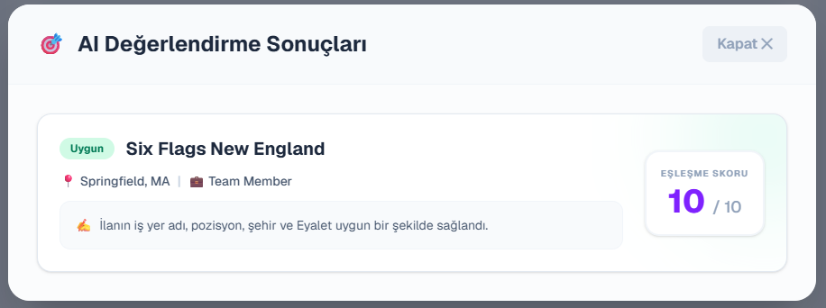
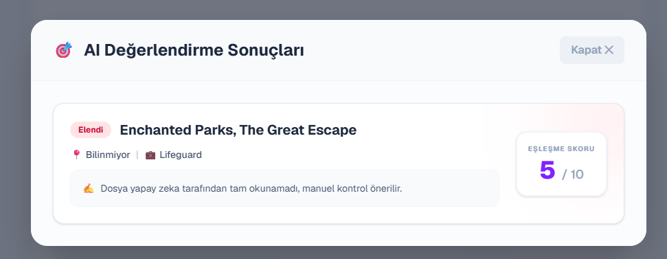

# ⚡ WAT Job Matcher (Powered by AI)

**WAT Job Matcher** is an advanced, AI-driven recruitment and job evaluation platform designed specifically for **Work and Travel (WAT)** participants. It automates the process of analyzing, scoring, and filtering job offer PDFs against custom user criteria using local Large Language Models (LLMs).

---

## 🎯 Key Features & AI Architecture

* **🧠 Local AI-Powered Analysis:** Utilizes Ollama (`qwen2.5:3b`) to intelligently parse unstructured job offer PDFs.
* **🛡️ C# Security Wall (Two-Layer Validation):** Prevents AI hallucination and mismatched scoring. Even if the AI returns a contradictory JSON flag, the backend text-analysis security layer intercepts and corrects the final score.
* **⚡ Concurrent PDF Processing:** Leverages asynchronous `Task.WhenAll` operations in ASP.NET Core to process multiple job offer PDFs simultaneously without performance bottlenecks.
* **🎨 Modern & Responsive UI:** Built with Next.js and Tailwind CSS, featuring a sleek, two-step wizard for criteria configuration and batch file uploads.

---

## 📸 User Interface & Workflow

### Step 1: Criteria Configuration
Users can customize evaluation parameters such as minimum openings, preferred states, acceptable position types, and date ranges.

  

### Step 2: Batch PDF Upload & Processing
Participants can upload multiple job offer PDFs and trigger the AI evaluation engine.

  

  

### Real-Time AI Analysis & Results Dashboard
The system evaluates each document, calculates match scores out of 10, categorizes them accurately as **"Uygun" (Suitable)** or **"Elendi" (Eliminated)** with robust security validation, and provides detailed reasoning.

  

  

  

---

## 🛠️ Tech Stack

* **Frontend:** Next.js (React), TypeScript, Tailwind CSS
* **Backend:** ASP.NET Core Web API (.NET 10), Entity Framework Core, SQLite (`watjobmatcher.db`)
* **AI Engine:** Ollama (`qwen2.5:3b`)
* **PDF Parser:** PdfPig (`UglyToad.PdfPig`)

---

## 🚀 Getting Started

### Prerequisites
* .NET 10 SDK installed
* Node.js & npm installed
* Ollama running locally with the `qwen2.5:3b` model (`ollama run qwen2.5:3b`)

### Running the Backend
cd src/WatJobMatcher.Api
dotnet run
(The API will start listening on http://localhost:5012)

### Running the Frontend
cd frontend
npm install
npm run dev
(The UI will run on http://localhost:3000)

📄 License
This project is open-source and available under the MIT License.
